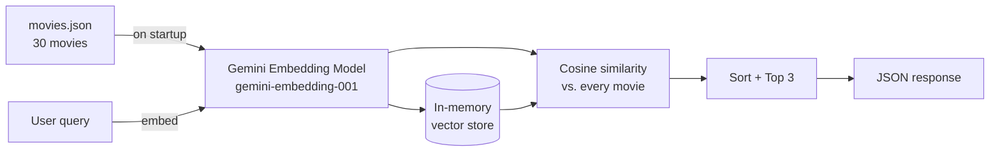

<div align="center">

# 🎬 Movie Match

**Semantic movie search and recommendations powered by embeddings and cosine similarity.**

Describe a movie in plain English, or pick one you love, and get the closest matches. No keyword matching, just meaning.


</div>

---

## ✨ What it does

Traditional search looks for matching words. Movie Match looks for matching **meaning**.

| You type | Keyword search finds | Movie Match finds |
|---|---|---|
| *"an astronaut stuck alone on a hostile planet"* | Nothing useful | **The Martian**, **Gravity**, **Interstellar** |
| *"a dream within a dream heist"* | Only exact word matches | **Inception** and thematically related films |

It exposes two REST endpoints:

- 🔍 **Semantic search**: describe a plot, mood, or vibe and get the top 3 matching movies.
- 🎯 **Similar movies**: give a movie title and get the top 3 most similar movies.

---

## 🧠 How it works



1. **Startup indexing.** When the app boots, every movie description in `movies.json` is converted into a high-dimensional vector (an *embedding*) using Google's `gemini-embedding-001` model via Spring AI. The vectors are held in memory.
2. **Query embedding.** For `/movie/search`, the user's text is embedded with the same model. For `/movie/{title}/similar`, the stored vector of that movie is reused, so no extra API call is needed.
3. **Cosine similarity.** The query vector is compared against every movie vector. Cosine similarity measures the angle between two vectors, so vectors pointing in the same direction mean similar meaning.
4. **Ranking.** Results are sorted by similarity score (highest first) and the top 3 are returned.

The cosine similarity is implemented **from scratch** in `MovieService.java`, with no vector database or math library.

---

## 🛠️ Tech stack

| Layer | Technology |
|---|---|
| Language | Java 21 |
| Framework | Spring Boot 4.1.1 (Spring MVC) |
| AI integration | Spring AI 2.0.1 |
| Embedding model | Google Gemini `gemini-embedding-001` |
| Build tool | Maven (wrapper included) |
| Boilerplate reduction | Lombok |

---

## 📡 API reference

Base URL: `http://localhost:8081`

### 1. Semantic search

```http
GET /movie/search?description={text}
```

**Example**

```bash
curl "http://localhost:8081/movie/search?description=an%20astronaut%20stranded%20on%20a%20hostile%20planet"
```

### 2. Find similar movies

```http
GET /movie/{title}/similar
```

The title match is case-insensitive. The movie itself is excluded from the results.

**Example**

```bash
curl "http://localhost:8081/movie/Inception/similar"
```

*(URL-encode titles with spaces, e.g. `The%20Dark%20Knight`.)*

### Response shape

Both endpoints return a JSON array of up to 3 results, ordered by similarity:

```json
[
  {
    "name": "Movie title",
    "description": "One-line plot description",
    "cosines": 0.0
  }
]
```

`cosines` is the cosine similarity score. Higher means more similar (the exact values depend on the embedding model).

---

## 🚀 Getting started

### Prerequisites

- **Java 21** or newer
- A free **Google Gemini API key**, which you can create at [Google AI Studio](https://aistudio.google.com/apikey)

No separate Maven install is needed because the Maven wrapper is included.

### 1. Clone the repository

```bash
git clone https://github.com/Yuganshhhh/movies-match-01.git
cd movies-match-01
```

### 2. Set your API key

The key is read from the `GEMINI_API_KEY` environment variable. It is **never** stored in the repository.

**Windows (PowerShell)**
```powershell
$env:GEMINI_API_KEY="your-api-key-here"
```

**macOS / Linux**
```bash
export GEMINI_API_KEY="your-api-key-here"
```

> 💡 In IntelliJ IDEA, you can instead add `GEMINI_API_KEY` under **Run → Edit Configurations → Environment variables**.

### 3. Run the application

**Windows**
```powershell
.\mvnw.cmd spring-boot:run
```

**macOS / Linux**
```bash
./mvnw spring-boot:run
```

On startup you should see a log line confirming that the movies were embedded:

```
30 movies loaded with embeddings successfully
```

The server then runs on **http://localhost:8081**.

---

## 🖥️ Demo frontend

Open **http://localhost:8081** in your browser once the app is running.

> ℹ️ **Note:** This project is about the **backend**: the embedding pipeline, the similarity engine, and the REST API. The bundled web UI (`src/main/resources/static/`) is a lightweight demo, included only to visualize what the API can do. It isn't the focus of this project.

---

## 📁 Project structure

```
movies-match-01/
├── pom.xml
├── src/main/
│   ├── java/com/yugansh/moviematch/
│   │   ├── MovieMatchApplication.java      # Spring Boot entry point
│   │   ├── controller/
│   │   │   └── MovieController.java        # REST endpoints
│   │   ├── service/
│   │   │   └── MovieService.java           # Embeddings, cosine similarity, ranking
│   │   └── model/
│   │       ├── MovieData.java              # Raw movie (name + description)
│   │       ├── MovieEmbedding.java         # Movie + its vector
│   │       └── MovieCosines.java           # API response: movie + score
│   └── resources/
│       ├── movies.json                     # Movie dataset (30 films)
│       ├── application.properties          # Config (port, model, API key env var)
│       └── static/                         # Demo frontend
└── src/test/                               # Spring Boot context test
```

---

## ⚠️ Current limitations

This is a learning-focused project, so a few things are deliberately simple:

- **Small dataset.** Only 30 movies, loaded from a JSON file.
- **In-memory vectors.** Embeddings are recomputed on every startup (30 API calls) and aren't persisted.
- **Brute-force search.** Every query is compared against every movie, which is fine at this scale but won't scale to millions of items.
- **Error handling.** An unknown movie title currently surfaces as a generic server error rather than a clean `404`.

## 🔮 Possible improvements

- [ ] Return a proper `404` with a helpful message for unknown titles
- [ ] Cache or persist embeddings to avoid re-embedding on every startup
- [ ] Move to a vector database (pgvector, Qdrant, etc.) for larger datasets
- [ ] Make the number of results configurable (`?limit=`)
- [ ] Add unit tests for the cosine similarity logic
- [ ] Add Dockerfile and CI pipeline

---

<div align="center">

Built by **[Yugansh Sharma](https://github.com/Yuganshhhh)** · Spring Boot · Spring AI · Gemini Embeddings

</div>
